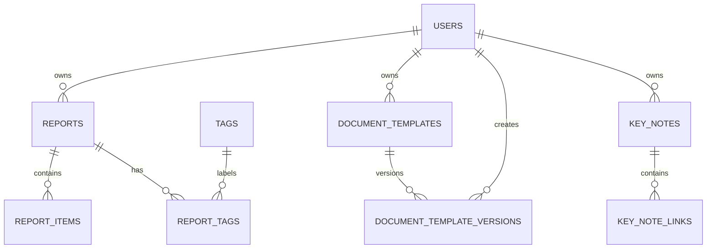

# Linetra 資料庫資料模型與安全設計

> 本文件依 2026-11-19 收到的 Supabase `public` schema、constraint、trigger、index、enum 與 RLS 匯出結果，以及 repository 目前的型別與資料存取程式整理。`youth_policy_update` enum migration 已於 Supabase 完成；目前僅保留 RLS 與共享資料權限的待確認決策。

## 1. 文件責任與資料來源

### 1.1 唯一來源分工

| 資料 | 目前應採用的來源 | 說明 |
| --- | --- | --- |
| 前端可用的資料表與欄位型別 | `frontend/src/types/database.types.ts` | 目前 repository 的型別快照，不等於遠端最新狀態 |
| 前端查詢與寫入行為 | `frontend/src/stores/`、`frontend/src/api/` | 確認哪些資料表目前真的被使用 |
| 正式資料庫 schema | Supabase 遠端 schema 或 migration | 本次以使用者提供的 CSV 快照校正 |
| 建置/初始化操作 | [supabase_setup_guide.md](../guides/supabase_setup_guide.md) | 操作步驟，不應成為第二份獨立 schema |
| 單次資料庫變更 | `docs/guides/*migration*.md` 或正式 migration 目錄 | 記錄變更原因與執行方式 |

### 1.2 目前驗證狀態

本次更新已完成 repository 與 Supabase CSV 快照比對。因此本文將資料分為：

- **Repository 已知**：型別與前端程式碼中已出現。
- **已由 Supabase 快照驗證**：欄位、欄位預設值、外鍵、主鍵、唯一鍵、部分 check constraint 與 trigger。
- **已由 Supabase 快照驗證**：完整 index、enum 值、function、外鍵參照與 RLS 開關/policy。
- **規劃中**：目前沒有前端型別或資料存取實作，不能視為已完成。

## 2. 目前 repository 已知的資料表

### 2.1 `users`：使用者 profile

目前遠端 `public.users` 已存在，且其他資料表的 `user_id` / `created_by` 會關聯至它。`id` 的實際參照來源與 `auth.users` 的同步方式仍需另外確認。

| 欄位 | 遠端型別 | 可空 | 預設值 |
| --- | --- | --- | --- |
| `id` | `uuid` | 否 | 無 |
| `email` | `text` | 否 | 無 |
| `name` | `text` | 是 | 無 |
| `avatar_url` | `text` | 是 | 無 |
| `created_at` | `timestamptz` | 是 | `now()` |
| `updated_at` | `timestamptz` | 是 | `now()` |

### 2.2 `reports`：案件通報主檔

| 欄位 | 型別 | 可空 | 說明 |
| --- | --- | --- | --- |
| `id` | `uuid` | 否 | 主鍵 |
| `user_id` | `uuid` | 否 | 擁有者，預期關聯 `users.id` |
| `template_type` | `template_type` | 否 | 遠端值：`general`、`meeting`、`weekly_report`、`briefing`、`announcement`、`task`、`meeting_simple` |
| `department` | `text` | 是 | 通報單位或承辦單位 |
| `subject` | `text` | 否 | 案件標題 |
| `remarks` | `text` | 是 | 備註 |
| `formatted_content` | `text` | 是 | 由模板策略產生的格式化內容 |
| `actual_due_at` | `timestamptz` | 是 | 實際期限 |
| `announced_due_at` | `timestamptz` | 是 | 對外公告期限 |
| `sent_at` | `timestamptz` | 是 | 首次送出時間 |
| `importance_flag` | `boolean` | 是 | `false` |
| `status` | `report_status` | 是 | `pending` |
| `created_at` | `timestamptz` | 是 | `now()` |
| `updated_at` | `timestamptz` | 是 | `now()` |
| `tags` | `text[]` | 是 | `{}` |

> **已完成同步：** Supabase 的 `template_type` enum 已新增 `youth_policy_update`，目前已與 `frontend/src/types/database.types.ts`、`frontend/src/types/models.ts` 及模板設定同步。此次 migration 未納入 repository migration 檔案，後續仍應補記 migration 歷史。

### 2.3 `report_items`：案件明細

| 欄位 | 型別 | 可空 | 說明 |
| --- | --- | --- | --- |
| `id` | `uuid` | 否 | 主鍵 |
| `report_id` | `uuid` | 否 | 關聯 `reports.id` |
| `item_type` | `report_item_type` | 否 | enum 值需另以 Supabase 查詢確認 |
| `content` | `text` | 否 | 明細內容 |
| `sort_order` | `smallint` | 是 | `0` |

### 2.4 `tags` 與 `report_tags`：案件標籤

`tags` 儲存標籤名稱；`report_tags` 是 `reports` 與 `tags` 的多對多關聯表。

| 資料表 | 主要欄位 | 關聯 |
| --- | --- | --- |
| `tags` | `id`, `name` | `name` 已有 unique constraint |
| `report_tags` | `report_id`, `tag_id` | 分別關聯 `reports.id` 與 `tags.id`，已使用複合 primary key |

### 2.5 `document_templates`：公文範本主檔

| 欄位 | 型別 | 可空 | 說明 |
| --- | --- | --- | --- |
| `id` | `uuid` | 否 | 主鍵 |
| `user_id` | `uuid` | 否 | 擁有者，預期關聯 `users.id` |
| `name` | `text` | 否 | 範本名稱 |
| `category` | `text` | 是 | 範本分類 |
| `is_active` | `boolean` | 否 | 是否啟用 |
| `created_at` | `timestamptz` | 否 | 建立時間 |
| `updated_at` | `timestamptz` | 否 | 更新時間 |

### 2.6 `document_template_versions`：公文範本版本

| 欄位 | 型別 | 可空 | 說明 |
| --- | --- | --- | --- |
| `id` | `uuid` | 否 | 主鍵 |
| `template_id` | `uuid` | 否 | 關聯 `document_templates.id` |
| `version_no` | `integer` | 否 | 範本版本號 |
| `content_markdown` | `text` | 否 | Markdown 內容 |
| `created_by` | `uuid` | 否 | 建立者，預期關聯 `users.id` |
| `created_at` | `timestamptz` | 否 | 建立時間 |

### 2.7 `key_notes`：重點記事

| 欄位 | 型別 | 可空 | 說明 |
| --- | --- | --- | --- |
| `id` | `uuid` | 否 | 主鍵 |
| `user_id` | `uuid` | 否 | 擁有者 |
| `title` | `text` | 否 | 記事標題 |
| `category` | `key_note_category` | 否 | enum 值需另以 Supabase 查詢確認 |
| `content` | `text` | 否 | 記事內容 |
| `is_pinned` | `boolean` | 否 | 是否置頂 |
| `sort_order` | `integer` | 否 | 顯示順序 |
| `status` | `key_note_status` | 否 | 預設 `active`，enum 值需另確認 |
| `valid_from` | `date` | 是 | 生效日期 |
| `valid_until` | `date` | 是 | 失效日期 |
| `created_at` | `timestamptz` | 否 | 建立時間 |
| `updated_at` | `timestamptz` | 否 | 更新時間 |

### 2.8 `key_note_links`：記事連結

| 欄位 | 型別 | 可空 | 說明 |
| --- | --- | --- | --- |
| `id` | `uuid` | 否 | 主鍵 |
| `note_id` | `uuid` | 否 | 關聯 `key_notes.id` |
| `label` | `text` | 否 | 連結顯示名稱 |
| `url` | `text` | 否 | 網址 |
| `sort_order` | `integer` | 否 | 顯示順序 |
| `created_at` | `timestamptz` | 否 | 建立時間 |

## 3. 目前前端未驗證的資料表與能力

### 3.1 `users`

前端型別中的多個 foreign key 指向 `users`，但目前 `database.types.ts` 沒有 `users` table 定義。需確認它是：

- Supabase `auth.users` 的直接關聯；或
- 自建的 `public.users` profile table；或
- 型別快照尚未完整產生。

在 Supabase 回傳結果確認前，不應在本文件宣稱其欄位或 trigger 已存在。

### 3.2 `notification_rules` 與 `notification_logs`

這兩張表目前只出現在規劃文件與 PRD，未出現在前端資料庫型別或 store 中。因此目前分類為 **規劃中**，不能作為已部署資料表使用。

若未來實作，應另外補充：

- migration 或建表 SQL
- `report_id`、`rule_id` 的外鍵與刪除行為
- notification worker 的 service role 權限邊界
- `dedup_key` 的唯一性與重試策略
- Edge Function 測試與失敗補償流程

## 4. Enum 定義

本次 Supabase 快照確認以下 enum：

| Enum | 遠端值 |
| --- | --- |
| `key_note_category` | `procedure`、`leader_instruction`、`reminder`、`website` |
| `key_note_status` | `active`、`archived` |
| `report_item_type` | `submission_method`、`detail`、`note`、`agenda`、`link`、`meeting_time`、`location`、`participants`、`materials`、`meeting_end_time` |
| `report_status` | `pending`、`completed`、`overdue`、`archived`、`deleted` |
| `template_type` | `general`、`meeting`、`weekly_report`、`briefing`、`announcement`、`task`、`meeting_simple` |

`youth_policy_update` 已於 2026-11-19 透過 Supabase migration 加入遠端 `template_type` enum。

## 5. 關聯模型



圖中的 `USERS` 代表目前文件假設的擁有者關聯，正式關聯目標需由 Supabase schema 確認。

## 6. RLS 設計原則

RLS 必須由資料庫層保護，不能只依賴 Vue 的篩選條件或 store 邏輯。至少應確認以下原則：

| 資料範圍 | 預期權限原則 |
| --- | --- |
| `reports` | 使用者只能讀寫自己的案件 |
| `report_items` | 必須透過所屬 `reports.user_id` 驗證擁有者 |
| `document_templates` | 使用者只能讀寫自己的範本 |
| `document_template_versions` | 必須透過所屬範本驗證擁有者 |
| `key_notes` | 使用者只能讀寫自己的記事 |
| `key_note_links` | 必須透過所屬記事驗證擁有者 |
| `tags` | 需明確決定是全域共享標籤或個人標籤，不能只用寬鬆的 authenticated policy 代替設計 |
| `report_tags` | 必須透過所屬案件驗證擁有者，不能只驗證登入身份 |
| `notification_logs` | 若由 worker 寫入，需明確限制 service role 與一般使用者的讀取範圍 |

### 6.1 Supabase 快照中的實際狀態

本次提供的 RLS 快照顯示，以下 9 張 `public` table 全部已啟用 RLS，且 `force_row_security` 全部為 `false`：

`users`、`reports`、`report_items`、`report_tags`、`tags`、`document_templates`、`document_template_versions`、`key_notes`、`key_note_links`。

目前 policy 可整理如下：

| 資料表 | Policy 範圍 | 實際條件 |
| --- | --- | --- |
| `users` | SELECT | `auth.uid() = id`，角色為 `public` |
| `reports` | ALL | `auth.uid() = user_id`，含 `WITH CHECK` |
| `report_items` | ALL | 透過 `reports.user_id = auth.uid()` 驗證案件擁有者 |
| `report_tags` | SELECT / INSERT / DELETE | 目前條件為 `true`，只限制角色為 `authenticated` |
| `tags` | SELECT / INSERT / UPDATE | 目前條件為 `true`，屬於所有 authenticated 使用者共享操作 |
| `document_templates` | ALL | `auth.uid() = user_id`，含 `WITH CHECK` |
| `document_template_versions` | ALL | 透過所屬範本的 `user_id = auth.uid()` 驗證 |
| `key_notes` | ALL | `auth.uid() = user_id`，含 `WITH CHECK` |
| `key_note_links` | ALL | 透過所屬記事的 `user_id = auth.uid()` 驗證 |

### 6.2 需要確認或修正的安全議題

1. `report_tags` 的 SELECT、INSERT、DELETE policy 都是 `true`。任何已登入使用者只要知道 ID，就可能讀取、建立或刪除其他使用者的案件標籤關聯。若案件標籤是個人資料，應改為透過 `reports.user_id = auth.uid()` 驗證；若標籤關聯刻意是共享資料，也應在文件中明確說明這個決策。
2. `tags` 的 policy 允許所有 authenticated 使用者更新任意標籤，這只有在標籤是全域共享字典時才合理。若標籤應屬於個人或組織，需增加 owner 欄位或改採擁有者關聯 policy。
3. `report_items` 的 policy 查詢結果 `with_check` 為 `null`。需確認 PostgreSQL 對 `ALL` policy 的實際套用方式，並建議明確補上與 `USING` 相同的 `WITH CHECK`，避免日後更新 `report_id` 時產生越權關聯。
4. `users` 只有 SELECT policy，且角色為 `public`；需確認是否刻意允許匿名角色進入 policy evaluation，實際資料仍由 `auth.uid() = id` 限制。若 profile 只供登入使用者使用，可考慮改為 `authenticated` 角色以縮小政策範圍。

目前 RLS 已大致符合 reports、templates、notes 的 owner 模型，但 `report_tags` 與 `tags` 的共享權限必須由產品需求確認後，才能判定是設計決策還是安全缺口。

### 6.3 待產品確認事項

以下事項先記錄於資料庫設計文件，暫不直接修改 Supabase policy：

| 編號 | 待確認事項 | 目前狀態 | 後續影響 |
| --- | --- | --- | --- |
| RLS-001 | `report_tags` 是否只能由案件擁有者操作？ | 待確認 | 若為個人資料，需將 SELECT、INSERT、DELETE 改為依 `reports.user_id = auth.uid()` 驗證 |
| RLS-002 | `tags` 是否為全域共享標籤？ | 待確認 | 若非共享資料，需增加 owner 關聯或改寫 policy |
| RLS-003 | `report_items` 是否補上明確的 `WITH CHECK`？ | 待確認 | 建議與目前 `USING` 條件一致，避免更新 `report_id` 造成越權關聯 |
| RLS-004 | `users` policy 是否應限縮為 `authenticated`？ | 待確認 | 若 profile 僅供登入使用者使用，應縮小 policy 角色範圍 |

在上述決策確認前，這些 policy 視為目前遠端狀態紀錄，不視為建議的最終安全設定。

## 7. Index、trigger 與 constraint

### 7.1 已由本次 Supabase 快照確認

- `reports`、`report_items`、`tags`、`report_tags`、`users`、`document_templates`、`document_template_versions`、`key_notes`、`key_note_links` 均存在。
- 各資料表均有 primary key。
- `reports.user_id`、`report_items.report_id`、`report_tags.report_id`、`report_tags.tag_id`、`document_templates.user_id`、`document_template_versions.template_id`、`document_template_versions.created_by`、`key_notes.user_id`、`key_note_links.note_id` 有 foreign key 快照。
- `tags.name` 有 unique constraint。
- `document_template_versions(template_id, version_no)` 有 unique constraint。
- `reports`、`document_templates`、`key_notes` 有 `handle_updated_at()` 的 `BEFORE UPDATE` trigger。
- `report_tags(report_id, tag_id)` 使用複合 primary key。
- `key_notes` 有 `valid_from <= valid_until` 的 check constraint；`key_note_links.url` 與 `document_template_versions.version_no` 也有 check constraint。

### 7.2 已驗證的正式 Index

目前 Supabase 已存在以下 index：

| 資料表 | Index | 定義 |
| --- | --- | --- |
| `document_template_versions` | `document_template_versions_pkey` | `(id)` unique |
| `document_template_versions` | `document_template_versions_template_id_version_no_key` | `(template_id, version_no)` unique |
| `document_template_versions` | `idx_template_versions_latest` | `(template_id, version_no DESC)` |
| `document_templates` | `document_templates_pkey` | `(id)` unique |
| `document_templates` | `idx_document_templates_owner_active` | `(user_id, is_active, category)` |
| `key_note_links` | `key_note_links_pkey` | `(id)` unique |
| `key_note_links` | `idx_key_note_links_order` | `(note_id, sort_order)` |
| `key_notes` | `key_notes_pkey` | `(id)` unique |
| `key_notes` | `idx_key_notes_owner_status` | `(user_id, status, category, is_pinned, sort_order)` |
| `report_items` | `report_items_pkey` | `(id)` unique |
| `report_tags` | `report_tags_pkey` | `(report_id, tag_id)` unique |
| `reports` | `reports_pkey` | `(id)` unique |
| `reports` | `idx_reports_status_pending` | `(status, announced_due_at)`，只限 `status = 'pending'` |
| `reports` | `idx_reports_user_status_due` | `(user_id, status, announced_due_at)` |
| `tags` | `tags_pkey` | `(id)` unique |
| `tags` | `tags_name_key` | `(name)` unique |
| `users` | `users_pkey` | `(id)` unique |

### 7.3 已驗證的 Function 與 Trigger

`public.handle_updated_at()` 的正式內容為：

```sql
CREATE OR REPLACE FUNCTION public.handle_updated_at()
RETURNS trigger
LANGUAGE plpgsql
AS $function$
BEGIN
  NEW.updated_at = now();
  RETURN NEW;
END;
$function$;
```

目前套用此 function 的 trigger：

| 資料表 | Trigger | 時機 |
| --- | --- | --- |
| `reports` | `tr_reports_updated_at` | `BEFORE UPDATE` |
| `document_templates` | `tr_document_templates_updated_at` | `BEFORE UPDATE` |
| `key_notes` | `tr_key_notes_updated_at` | `BEFORE UPDATE` |

### 7.4 已驗證的外鍵刪除行為

| 外鍵 | 參照 | `ON DELETE` |
| --- | --- | --- |
| `users.id` | `auth.users(id)` | `CASCADE` |
| `reports.user_id` | `users(id)` | `CASCADE` |
| `report_items.report_id` | `reports(id)` | `CASCADE` |
| `report_tags.report_id` | `reports(id)` | `CASCADE` |
| `report_tags.tag_id` | `tags(id)` | `CASCADE` |
| `document_templates.user_id` | `users(id)` | `CASCADE` |
| `document_template_versions.template_id` | `document_templates(id)` | `CASCADE` |
| `document_template_versions.created_by` | `users(id)` | `RESTRICT` |
| `key_notes.user_id` | `users(id)` | `CASCADE` |
| `key_note_links.note_id` | `key_notes(id)` | `CASCADE` |

## 8. 與其他資料庫文件的分工

| 文件 | 保留內容 | 應避免內容 |
| --- | --- | --- |
| 本文件 | 目前模型、關聯、RLS 原則、驗證狀態 | 重複完整初始化腳本 |
| [supabase_setup_guide.md](../guides/supabase_setup_guide.md) | 建立專案、執行 migration、驗證環境 | 另一份長期維護的 schema 定義 |
| [document_template_and_key_notes_lecture.md](../guides/document_template_and_key_notes_lecture.md) | 功能需求、使用流程、範本與記事規則 | 取代本文件維護資料表欄位 |
| `docs/guides/*migration*.md` | 單次變更背景、前後差異、執行步驟 | 宣稱代表目前完整 schema |
| [edge_functions_design.md](edge_functions_design.md) | 通知資料表被 worker 使用時的流程 | 在沒有實作時宣稱已部署 |

## 9. 取得 Supabase 最新 schema 的方式

請在 Supabase SQL Editor 執行以下查詢，將完整結果提供給我；不要提供 API key、service role key 或其他密碼：

```sql
-- 1. public schema 的資料表與欄位
select
  table_name,
  column_name,
  ordinal_position,
  data_type,
  udt_name,
  is_nullable,
  column_default
from information_schema.columns
where table_schema = 'public'
order by table_name, ordinal_position;
```

```sql
-- 2. 外鍵、唯一鍵與主鍵
select
  tc.table_name,
  tc.constraint_name,
  tc.constraint_type,
  kcu.column_name,
  ccu.table_name as foreign_table_name,
  ccu.column_name as foreign_column_name
from information_schema.table_constraints tc
left join information_schema.key_column_usage kcu
  on tc.constraint_name = kcu.constraint_name
 and tc.table_schema = kcu.table_schema
left join information_schema.constraint_column_usage ccu
  on tc.constraint_name = ccu.constraint_name
 and tc.table_schema = ccu.table_schema
where tc.table_schema = 'public'
order by tc.table_name, tc.constraint_name, kcu.ordinal_position;
```

```sql
-- 3a. RLS 開關狀態（rowsecurity 不在 pg_policies，而在 pg_class）
select
  n.nspname as schemaname,
  c.relname as tablename,
  c.relrowsecurity as rowsecurity,
  c.relforcerowsecurity as force_row_security
from pg_class c
join pg_namespace n on n.oid = c.relnamespace
where n.nspname = 'public'
  and c.relkind = 'r'
order by c.relname;
```

```sql
-- 3b. RLS policy 詳細內容
select
  p.schemaname,
  p.tablename,
  c.relrowsecurity as rowsecurity,
  p.policyname,
  p.permissive,
  p.roles,
  p.cmd,
  p.qual,
  p.with_check
from pg_policies p
join pg_class c on c.relname = p.tablename
join pg_namespace n
  on n.oid = c.relnamespace
 and n.nspname = p.schemaname
where p.schemaname = 'public'
order by p.tablename, p.policyname;
```

```sql
-- 4. index、trigger 與 function
select tablename, indexname, indexdef
from pg_indexes
where schemaname = 'public'
order by tablename, indexname;

select
  event_object_table as table_name,
  trigger_name,
  action_timing,
  event_manipulation,
  action_statement
from information_schema.triggers
where event_object_schema = 'public'
order by event_object_table, trigger_name;
```

另外建議補充 enum 值與 function 定義：

```sql
select
  n.nspname as schema_name,
  t.typname as enum_name,
  e.enumsortorder,
  e.enumlabel
from pg_type t
join pg_enum e on e.enumtypid = t.oid
join pg_namespace n on n.oid = t.typnamespace
where n.nspname = 'public'
order by t.typname, e.enumsortorder;
```

```sql
select
  n.nspname as schema_name,
  p.proname as function_name,
  pg_get_function_identity_arguments(p.oid) as arguments,
  pg_get_functiondef(p.oid) as definition
from pg_proc p
join pg_namespace n on n.oid = p.pronamespace
where n.nspname = 'public'
order by p.proname;
```

完成上述 RLS 決策，並補記 `youth_policy_update` migration 歷史後，本文即可從 `Verified with Pending Decisions` 更新為完整驗證版本。
