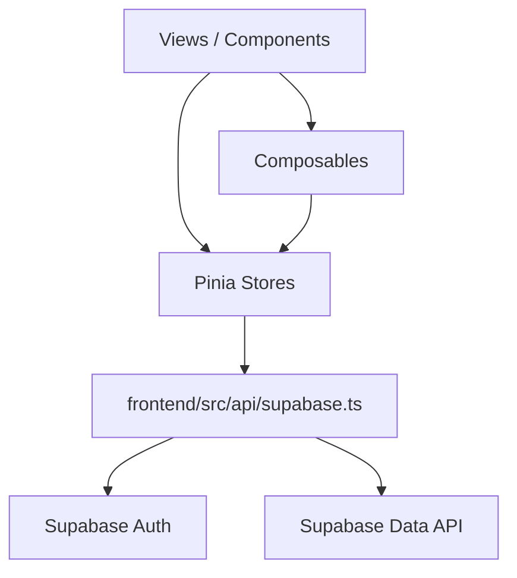

# Linetra 專案架構與開發規範指南

| 屬性 (Metadata) | 內容 (Content) |
| :--- | :--- |
| **文件版本 (Version)** | `v1.2` |
| **文件狀態 (Status)** | `Active` |
| **建立日期 (Created Date)** | 2026-05-24 |
| **最後更新 (Last Updated)** | 2026-11-19 |
| **主要作者 (Author)** | Linetra Dev Team |
| **適用範圍 (Scope)** | Linetra monorepo、前端功能、報告模板、測試與文件流程 |

## 1. 架構現況

Linetra 目前是一個以 Vue 3、TypeScript、Vite 與 Supabase Client 為核心的前端應用程式。資料存取透過 `frontend/src/api/supabase.ts` 與 Pinia stores 封裝；目前 repository 沒有獨立的 `backend/` 或 `supabase/` 目錄，也沒有在本地維護 Edge Functions 或 migration 原始碼。

因此，新增功能時應以目前 repository 的實際結構為準，不應直接套用尚未建立的 backend、CI/CD 或 Supabase CLI 目錄。

### 1.1 技術邊界

```text
使用者介面
    |
    v
Vue Views / Components
    |
    v
Composables -------- Config / Metadata
    |                         |
    v                         v
Pinia Stores -------- Shared Types / Schemas
    |
    v
Supabase Client API
```

各層的責任如下：

| 層級 | 主要位置 | 責任 |
| :--- | :--- | :--- |
| Views | `frontend/src/views/` | 頁面組合、路由狀態、使用者操作與畫面流程 |
| Components | `frontend/src/components/` | 可重用的 UI 元件，不負責跨頁面資料流程 |
| Composables | `frontend/src/composables/` | 可重用的表單、格式化、Calendar、輸出與生命週期邏輯 |
| Config | `frontend/src/config/` | 靜態 registry、選項、模板 metadata 與顯示名稱 |
| Stores | `frontend/src/stores/` | Pinia 狀態、Supabase 查詢與資料同步 |
| API | `frontend/src/api/` | Supabase client 與底層連線設定 |
| Types | `frontend/src/types/` | 資料模型、資料庫型別、Zod schema 與共用 enum |
| Tests | `frontend/tests/` | composables、components、views、stores、config 與 schemas 測試 |

## 2. Repository 目錄結構

目前實際使用的主要目錄如下：

```text
D:\Repos\Linetra\
├── frontend/
│   ├── src/
│   │   ├── api/
│   │   │   └── supabase.ts
│   │   ├── components/
│   │   │   ├── common/
│   │   │   ├── fab/
│   │   │   └── layout/
│   │   ├── composables/
│   │   │   ├── reportStrategies/
│   │   │   ├── useReportForm.ts
│   │   │   ├── useReportTemplate.ts
│   │   │   ├── useReportLifecycle.ts
│   │   │   └── useFABActions.ts
│   │   ├── config/
│   │   │   ├── reportTemplates.ts
│   │   │   └── reportTypes.ts
│   │   ├── router/
│   │   ├── stores/
│   │   ├── types/
│   │   │   ├── models.ts
│   │   │   ├── database.types.ts
│   │   │   └── schemas.ts
│   │   ├── views/
│   │   ├── App.vue
│   │   └── main.ts
│   ├── tests/
│   │   ├── components/
│   │   ├── composables/
│   │   ├── config/
│   │   ├── stores/
│   │   ├── types/
│   │   └── views/
│   ├── package.json
│   ├── package-lock.json
│   ├── vite.config.ts
│   ├── vitest.config.ts
│   └── README.md
├── docs/
│   ├── api/
│   ├── architecture/
│   ├── guides/
│   ├── history/
│   └── product/
├── tools/
│   ├── git-hooks/
│   └── skills/
├── README.md
├── AGENTS.md
└── LICENSE
```

### 2.1 目錄使用規則

- `frontend/src/views/` 只放頁面層，不複製既有 composable 的商業邏輯。
- `frontend/src/components/` 放可重用 UI；需要資料查詢時應透過 props、emits 或既有 store/composable。
- `frontend/src/composables/` 放可被多個 View 或 Component 使用的邏輯。
- `frontend/src/config/` 放靜態設定與 registry，不在 View 內散落模板清單。
- `frontend/src/stores/` 負責跨頁面狀態與 Supabase 資料操作。
- `frontend/src/types/` 是型別與驗證規則的共用來源。
- `frontend/tests/` 的測試目錄應對應被測試的 source 層級。
- `docs/guides/` 放長期有效的開發指南；`docs/history/` 放每次 commit 的變更脈絡。

## 3. 報告功能架構

報告功能目前分成四種頂層表單模式：

```text
ReportFormTab
├── general       一般模式
├── template      模板模式
├── announcement  公告模式
└── task          任務模式
```

模板類型則由 `TemplateType` 管理：

```text
TemplateType
├── general
├── meeting
├── meeting_simple
├── weekly_report
├── briefing
├── youth_policy_update
├── announcement
└── task
```

`ReportTemplateType` 會排除 `general`、`announcement` 與 `task`，代表真正由模板 registry 管理的類型。新增一般模板時，應新增 `ReportTemplateType`，不要新增 `ReportFormTab`。

### 3.1 報告建立與編輯流程

```text
ReportCreateView.vue
    |
    v
useReportForm()
    |
    +--> updateMode()
    |       +--> general / announcement / task
    |
    +--> applyTemplate()
            +--> REPORT_TEMPLATES[type]
            +--> defaultSubject
            +--> defaultDepartment
            +--> defaultAnnouncedDueAt
            +--> behavior.initialStatus
            +--> items / inputType
    |
    v
useReportTemplate().generateLineText()
    |
    v
reportStrategies/index.ts
    |
    v
formatted_content + report_items + report metadata
    |
    v
Pinia report store / Supabase
```

編輯既有報告時，`ReportCreateView.vue` 先載入報告與 items，再依 `template_type` 補回模板 metadata，例如 `inputType` 與 `behavior`。既有報告的資料不應被初始化預設值覆蓋。

## 4. 模板 metadata 與 Strategy Registry

### 4.1 模板設定來源

所有模板預設值集中於：

```text
frontend/src/config/reportTemplates.ts
```

`TemplateConfig` 目前包含：

| 欄位 | 用途 |
| :--- | :--- |
| `id` | 模板穩定識別值 |
| `name` | 模板選單與篩選器顯示名稱 |
| `defaultSubject` | 新報告預設案由 |
| `defaultDepartment` | 新報告預設通報單位 |
| `defaultAnnouncedDueAt` | 新報告預設對外通知期限 |
| `behavior` | 模板的 lifecycle、輸入與下游行為 metadata |
| `items` | 新報告初始項目與預設內容 |

`TemplateBehavior` 目前包含：

| 欄位 | 值 | 用途 |
| :--- | :--- | :--- |
| `showDepartment` | boolean | 模板模式是否顯示通報單位欄位 |
| `showDueDates` | boolean | 建立頁、卡片與詳細頁是否顯示期限 |
| `calendarMode` | `none` / `deadline` / `meeting` | Calendar 事件產生方式 |
| `initialStatus` | `pending` / `completed` 等 | 新報告的初始狀態 |

欄位輸入方式由 item 的 `inputType` 描述：

```ts
type TemplateInputType = 'text' | 'textarea' | 'datetime-local'
```

### 4.2 Strategy 分層

輸出策略位於：

```text
frontend/src/composables/reportStrategies/
├── types.ts
├── baseStrategy.ts
├── generalStrategy.ts
├── meetingStrategy.ts
├── meetingSimpleStrategy.ts
├── weeklyStrategy.ts
├── briefingStrategy.ts
├── announcementStrategy.ts
├── taskStrategy.ts
└── index.ts
```

`index.ts` 是唯一 registry：

```ts
export const strategies: Record<TemplateType, ReportStrategy> = {
  general: new GeneralStrategy(),
  meeting: new MeetingStrategy(),
  meeting_simple: new MeetingSimpleStrategy(),
  weekly_report: new WeeklyStrategy(),
  briefing: new BriefingStrategy(),
  youth_policy_update: new GeneralStrategy(),
  announcement: new AnnouncementStrategy(),
  task: new TaskStrategy(),
}
```

如果新模板輸出格式與一般案件相同，應重用 `GeneralStrategy`，不應複製 class。只有輸出標題、段落、欄位順序或格式真的不同時，才新增 Strategy 檔案。

`useReportStrategies.ts` 保留為相容性匯出入口；新增程式碼應優先使用 `reportStrategies/index.ts` 與其型別，不要重新建立另一份 registry。

### 4.3 下游行為統一入口

`getReportBehavior(templateType)` 位於 `frontend/src/config/reportTemplates.ts`，負責提供模板與非模板類型的下游預設行為。

目前使用位置包括：

- `useFABActions.ts`：Calendar mode。
- `ReportCard.vue`：期限顯示。
- `ReportDetailView.vue`：期限欄位顯示。
- `useReportLifecycle.ts`：新報告初始狀態。

不要在上述檔案新增以下形式的模板特例：

```ts
templateType === 'some_new_template'
```

應優先在 `TemplateBehavior` 增加可重用設定，再由下游讀取 metadata。

## 5. 共用型別與資料驗證

### 5.1 型別來源

共用型別位於 `frontend/src/types/models.ts`：

- `TemplateType`：所有報告類型。
- `ReportTemplateType`：模板模式實際使用的模板類型。
- `ItemType`：報告 item 類型。
- `Report`、`ReportInsert`、`ReportItem`：資料庫模型衍生型別。

資料庫表格型別位於 `frontend/src/types/database.types.ts`。新增 `template_type` 或 `item_type` 時，必須同步確認 Row、Insert、Update 三種型別。

### 5.2 Zod schema

`frontend/src/types/schemas.ts` 使用 `models.ts` 的共用常數產生 `TemplateTypeSchema` 與 `ItemTypeSchema`，避免手動維護兩份 enum。

新增型別後必須確認：

1. `TemplateType` 或 `ItemType` 常數已加入。
2. database types 已同步。
3. Zod schema 可以 parse 新值。
4. `frontend/tests/types/schemas.spec.ts` 有對應測試。

若資料庫實際有 PostgreSQL enum 或 check constraint，還必須在資料庫端先完成 migration；前端型別不能取代資料庫 schema 變更。

## 6. Store、API 與資料流規範

### 6.1 API

`frontend/src/api/supabase.ts` 只負責建立 Supabase client 與連線設定。元件不應直接在 template 或事件 handler 中建立 Supabase client。

### 6.2 Stores

`frontend/src/stores/reports.ts` 負責報告與 items 的查詢、建立、更新、刪除及目前報告狀態。View 應透過 store 操作資料，不要在多個 View 重複實作相同 query。

`frontend/src/stores/auth.ts` 負責登入使用者；需要 user id 或 email 時，應透過 auth store 取得。

### 6.3 Composables

- `useReportForm.ts`：表單 state、模式切換、模板套用與 items。
- `useReportTemplate.ts`：依 `template_type` 選擇輸出 strategy。
- `useReportLifecycle.ts`：初始 status 與 sent_at 規則。
- `useReportItemFormatter.ts`：item 顯示格式化。
- `useTimeFormatter.ts`：日期、相對時間與期限格式化。
- `useFABActions.ts`：頁面快速操作與 Calendar 整合。
- `useReportFilters.ts`：Dashboard 篩選條件與 localStorage 狀態。

若邏輯會被兩個以上元件使用，優先放入 composable；若只是單一畫面的純 UI 組合，留在 View。

## 7. 測試架構與品質門檻

測試位於 `frontend/tests/`，目前主要分類如下：

| 測試目錄 | 測試內容 |
| :--- | :--- |
| `tests/config/` | 模板 registry 與 metadata |
| `tests/types/` | Zod schema 與共用型別驗證 |
| `tests/composables/` | 表單、lifecycle、Strategy、Calendar、formatter |
| `tests/components/` | 卡片、篩選器、搜尋框與 modal |
| `tests/views/` | 詳細頁與任務頁等頁面行為 |
| `tests/stores/` | Pinia store 行為 |

新增或重構功能時，至少需要：

1. 先建立或補充會失敗的行為測試。
2. 實作最小變更。
3. 執行 targeted tests。
4. 執行完整測試。
5. 執行 `npm run build`，確認 `vue-tsc` 與 Vite build。

標準指令：

```powershell
cd frontend
npx vitest run
npm run build
```

目前測試腳本也支援：

```powershell
npm run test
npm run test:ui
```

不要用刪除測試、放寬型別、跳過錯誤或修改預期值的方式掩蓋回歸。

## 8. 文件與變更追蹤

### 8.1 文件分類

- `docs/product/`：PRD、user stories、產品視覺規範。
- `docs/architecture/`：系統、資料庫、狀態機與 Edge Functions 設計文件。
- `docs/api/`：OpenAPI 與 API 契約。
- `docs/guides/`：長期有效的開發、設定與功能擴充指南。
- `docs/history/`：每次 commit 的異動原因、方向、檔案清單與驗證結果。
- `docs/product/COMMIT_LOG.md`：由 Git Hook 維護的提交摘要 log。

報告模板詳細擴充方式請參考：

[報告模板新增與擴充指南](report_template_extension_guide.md)

### 8.2 Markdown 規範

除 `README.md` 外，所有 Markdown 文件必須：

- 以 YAML front matter 開頭。
- 包含 metadata table。
- 不使用 emoji。
- 使用繁體中文描述專案規則與決策。

### 8.3 每次 commit 前的要求

每次 commit 前必須：

1. 在 `docs/history/` 建立本次提交的歷史紀錄。
2. 寫明異動原因、改動方向、實際修改檔案與測試結果。
3. 檢查根目錄 `README.md` 與 `frontend/README.md` 是否需要同步更新。
4. 執行 `git diff --staged` 與 `git diff --staged --check`。
5. 使用 Conventional Commits：`<type>(<scope>): <subject>`。
6. 讓 Git Hook 驗證 commit message 並更新 `COMMIT_LOG.md`。

建議 commit scope：

- `frontend`：前端功能、元件、composables、stores。
- `docs`：文件與指南。
- `db`：資料庫 schema、RLS、migration。
- `tools`：Git hooks、skills 與自動化工具。
- `root`：根目錄設定或跨模組變更。

## 9. 新增功能的標準工作流程

```text
確認需求與影響範圍
    |
    v
先建立或補充測試
    |
    v
修改單一架構層
    |
    v
targeted tests
    |
    v
完整 tests + build
    |
    v
更新 docs/history 與 README 檢查結果
    |
    v
分階段 commit
```

每個階段只處理一類變更。例如模板功能可以拆成：

1. 回歸測試。
2. metadata 模型。
3. form initialization。
4. View metadata 渲染。
5. 型別與 schema。
6. Strategy 拆分。
7. 下游 Calendar、Card、Detail 行為。
8. 實際新增模板。

完成一個階段並確認測試通過後，才進入下一階段。

## 10. 不應採用的做法

- 不要在 `ReportCreateView.vue` 複製另一份整套模板表單。
- 不要在 Calendar、Card、Detail 各自新增同一個模板 ID 判斷。
- 不要在 `REPORT_TEMPLATES` 之外建立第二份模板清單。
- 不要在 `schemas.ts` 手動維護與 `models.ts` 不一致的 enum。
- 不要把 Supabase query 散落在 View 或 Component。
- 不要把輸出格式、表單顯示與資料庫儲存混在同一個 Strategy。
- 不要為了單一模板增加新的表單模式。
- 不要把歷史紀錄寫入 `COMMIT_LOG.md` 取代 `docs/history/` 的詳細說明。
- 不要在未確認資料庫 schema 的情況下新增 enum 值並直接部署。

## 11. 維護檢查清單

AI 或開發者修改架構前，應確認：

- [ ] 變更符合目前實際目錄，而不是過時的 backend 或 Supabase 目錄假設。
- [ ] 新增報告模板時已閱讀 `report_template_extension_guide.md`。
- [ ] registry、型別、schema 與 database types 保持一致。
- [ ] UI 行為由 metadata 驅動，而不是散落模板 ID 判斷。
- [ ] Strategy 只處理輸出格式。
- [ ] Store 只處理資料與跨頁面狀態。
- [ ] 新功能有 targeted tests。
- [ ] 完整 tests 通過。
- [ ] `npm run build` 通過。
- [ ] Markdown 文件符合 front matter、metadata table 與語言規範。
- [ ] 已建立 `docs/history` 紀錄。
- [ ] 已檢查 `README.md` 與 `frontend/README.md`。
## 12. 前端架構規格

本節整合原 `docs/guides/frontend_spec.md` 的前端架構內容。前端技術分層與 repository 規範集中於本文件，避免 architecture 與 guide 產生兩份互相分叉的前端架構說明。

### 12.1 技術基礎

| 領域 | 目前技術 |
| --- | --- |
| UI framework | Vue 3 Composition API |
| Build tool | Vite |
| Language | TypeScript |
| State management | Pinia |
| Routing | Vue Router 4 |
| Styling | Tailwind CSS、SCSS/CSS |
| Data service | `@supabase/supabase-js` |
| Validation | Zod |
| Testing | Vitest、Vue Test Utils |
| Formatting/linting | Prettier、ESLint |

### 12.2 前端資料流



- View / component：負責畫面呈現、互動與事件轉接。
- Composable：負責可重用的表單、生命週期、篩選、格式化與模板流程。
- Store：負責跨畫面狀態、Supabase 查詢、寫入與 loading/error 狀態。
- Supabase client：集中於 `frontend/src/api/supabase.ts`，不在元件內重複建立 client。

### 12.3 前端型別與 Supabase 同步

- `frontend/src/types/database.types.ts`：Supabase database type snapshot。
- `frontend/src/types/models.ts`：前端 domain model、模板與 item type。
- `frontend/src/types/schemas.ts`：Zod input validation。

Supabase schema 變更時，應依序更新 migration、database types、domain model、schema、stores、composables 與測試。前端型別不能取代 PostgreSQL RLS。

### 12.4 Store 與 Composable 責任

- `auth.ts`：session、登入、登出與 Auth 狀態。
- `reports.ts`：案件、報告項目與標籤資料操作。
- `knowledge.ts`：公文範本、範本版本、重點記事與記事連結。
- `useReportForm.ts`：表單初始化、模板切換與欄位狀態。
- `useReportTemplate.ts`：依模板 strategy 產生內容。
- `useReportLifecycle.ts`：建立時預設狀態與生命週期。
- `useReportFilters.ts`：案件搜尋與篩選狀態。
- `useFABActions.ts`：FAB 動作與路由導向。
- `useTimeFormatter.ts`：日期與時間格式化。

Store 不應包含特定元件的 DOM 操作；View 不應直接撰寫複雜 Supabase query。

### 12.5 前端測試分層

```text
frontend/tests/
├── components/   # Vue component 行為與互動
├── composables/  # 表單、生命週期、模板策略與篩選邏輯
├── config/       # 模板 metadata 與行為
├── stores/       # Supabase 查詢、寫入與錯誤處理
├── types/        # Zod schema 與型別驗證
└── views/        # 頁面流程與路由層級行為
```

新增功能至少覆蓋正常流程、邊界條件、錯誤回應，以及新增的模板、狀態或資料欄位。架構重構時，先確認重構前測試通過，再分階段修改與驗證。
