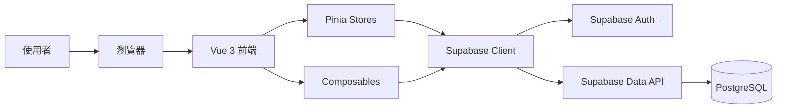
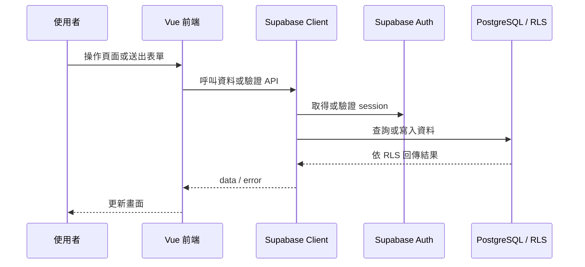

# Linetra 系統架構總覽

> 本文件描述 Linetra 的系統邊界、主要執行元件與資料流。它是架構總覽，不取代資料庫、狀態機、Edge Functions 或前端程式架構文件。

## 1. 目前架構定位

Linetra 目前是以 Vue 3、TypeScript、Vite、Pinia 與 Supabase Client 為核心的前端應用程式。資料存取與驗證透過 Supabase 提供的服務完成；repository 目前沒有獨立的 `backend/`、`supabase/` 或 Edge Functions 原始碼目錄。

目前程式碼中的主要入口如下：

| 能力 | 實作位置 | 目前狀態 |
| --- | --- | --- |
| Supabase Client | `frontend/src/api/supabase.ts` | 已實作 |
| 使用者登入與登出 | `frontend/src/stores/auth.ts` | 已實作 |
| 報告與報告項目資料存取 | `frontend/src/stores/reports.ts` | 已實作 |
| 知識庫資料存取 | `frontend/src/stores/knowledge.ts` | 已實作 |
| 資料型別 | `frontend/src/types/database.types.ts` | 已維護前端型別 |
| Supabase Edge Functions | `supabase/` 或其他 backend 目錄 | repository 尚未提供原始碼 |
| Cron、逾期掃描與推播 | 外部 Supabase 設定或服務 | 本文件只保留規劃邊界，不視為已完成能力 |

## 2. 系統分層

### 2.1 前端呈現層

Vue views 與 components 負責頁面呈現、使用者互動與表單輸入。報告模板的欄位與行為由 `frontend/src/config/reportTemplates.ts`、`frontend/src/config/reportTypes.ts` 與 `frontend/src/composables/reportStrategies/` 協作提供。

### 2.2 前端狀態與流程層

Pinia stores 負責跨頁面狀態與資料操作；composables 負責表單初始化、生命週期、篩選與模板策略等可重用流程。具體規範與目錄責任請參考 [project_architecture_guidelines.md](project_architecture_guidelines.md)。

### 2.3 Supabase 服務層

- **Auth**：提供登入、登出與 session 管理。
- **Data API**：由 Supabase Client 呼叫資料表查詢、建立、更新與刪除。
- **PostgreSQL**：儲存 reports、report_items、tags、knowledge 等資料。
- **RLS**：資料庫層的權限控制；實際政策與 SQL 應以資料庫設計文件及部署環境為準。

## 3. 資料流與安全邊界

前端只使用 Supabase publishable key，透過目前登入 session 取得使用者身份。資料存取的最終權限不得只依賴前端判斷，應由 PostgreSQL RLS 及 Supabase Auth session 共同保護。

## 4. 未納入目前 repository 的能力

以下內容可以作為系統規劃，但不能在本文件中描述成已完成的 repository 實作：

- Supabase Edge Functions 原始碼與部署流程
- pg_cron 或其他排程設定
- 逾期案件掃描與通知派送
- Web Push、瀏覽器通知或其他外部通知服務
- Vercel、Netlify 或 Cloudflare Pages 的正式部署設定

若未來加入上述能力，應同步新增或更新對應的實作目錄、測試與文件，並在本文件的元件表中標示狀態。

## 5. 文件責任分界

| 文件 | 負責內容 | 不負責內容 |
| --- | --- | --- |
| 本文件 | 系統邊界、元件關係、資料流與目前/規劃中狀態 | 詳細 SQL、前端單一功能實作 |
| [project_architecture_guidelines.md](project_architecture_guidelines.md) | repository 結構、前端分層、模板架構、測試與開發規範 | 部署環境的詳細 SQL 或服務設定 |
| [database_design.md](database_design.md) | 資料表、欄位、RLS、索引與資料庫觸發器 | Vue 元件與前端流程 |
| [state_machine.md](state_machine.md) | 報告狀態與生命週期規則 | 資料庫完整 schema |
| [edge_functions_design.md](edge_functions_design.md) | Edge Functions、Cron 與通知的規劃 | 已存在的前端功能清單 |

若不同文件內容衝突，應以實際程式碼、部署環境與最新的專責文件為準，並回頭修正本總覽文件。

## 6. 變更維護規則

架構有以下變更時，應檢查本文件是否需要更新：

1. 新增或移除主要執行元件。
2. 改變前端與 Supabase 的資料流或驗證方式。
3. 將規劃中的 Edge Functions、排程或通知功能正式加入 repository。
4. 更換部署平台或資料服務。
5. 新增文件責任領域，造成現有文件分工改變。

每次 commit 前也應確認根目錄 [README.md](../../README.md) 與 [frontend/README.md](../../frontend/README.md) 是否需要同步更新；若有更新，應在 `docs/history/` 留下本次變更紀錄。
